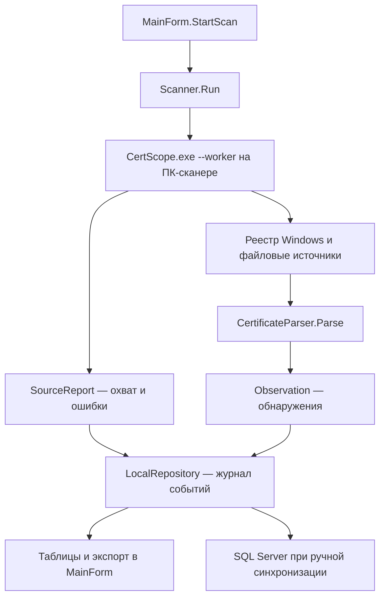

# CertScope — документация к коду

CertScope инвентаризирует открытые сертификаты X.509 из файлов и хранилищ Windows. Приложение хранит сертификат, место и время его обнаружения, а также состояние проверки каждого источника. Интерфейс работает на WinForms. Основной язык — C# 5, целевая платформа — .NET Framework 4.5, сборка — AnyCPU. SQL Server 2019 используется для отдельной синхронизации.

Инструкция оператора находится в [README](../README.md). Подготовка удалённого компьютера описана в [сетевой инструкции](target-setup.md), команды сборки и тестирования — в [инструкции разработчика](TESTING.md).

## Карта исходников

| Файл | За что отвечает |
| --- | --- |
| [Program.cs](../src/Program.cs) | Точка входа WinForms и внутреннего режима `--worker`. Журнал ошибок `AppLog`. |
| [MainForm.cs](../src/MainForm.cs) | Форма, настройки, команды сканирования, импорт, фильтры, экспорт и запуск синхронизации. |
| [VisualTheme.cs](../src/VisualTheme.cs) | Стиль, отрисовка кнопок, вкладок, панелей и пиктограмм. |
| [Models.cs](../src/Models.cs) | Контракты данных, проверка настроек и JSON-сериализация. |
| [Scanner.cs](../src/Scanner.cs) | Построение заданий, запуск процессов сбора, чтение реестра и файлов, диагностика охвата. |
| [CertificateParser.cs](../src/CertificateParser.cs) | Определение формата по содержимому, разбор X.509 и извлечение исходного открытого DER. |
| [Persistence.cs](../src/Persistence.cs) | Локальный журнал, проверка событий, SQL-схема и доставка событий. |
| [Exports.cs](../src/Exports.cs) | Формирование XLSX, TXT и CER. |
| [schema.sql](../sql/schema.sql) | Скрипт создания таблиц в существующей БД для администратора SQL Server. |
| [deploy/](../deploy) | Одноразовая настройка целевого ПК с ограниченным доступом к хранилищам сертификатов. |

## Как проходит сканирование

1. `MainForm.StartScan` считывает форму, проверяет и сохраняет `ScanSettings`. Для запуска создаётся отдельный снимок настроек. Относительные пути к файлам разворачиваются относительно папки приложения.
2. `Scanner.Run` создаёт `ScanId`, убирает повторяющиеся имена компьютеров и строит список заданий. Для профилей есть предварительное задание `Discover`, которое может добавить источники. Для каждого компьютера формируется итоговый отчёт с источником «Компьютер».
3. `Scanner.Execute` запускает тот же EXE на ПК-сканере с аргументом `--worker` для каждой попытки чтения источника. Запрос передаётся через стандартный ввод, сообщения о результатах, диагностике и найденных источниках идут через стандартный вывод. Протокол — UTF-8 и один JSON-объект на строку.
4. `Collector` в рабочем процессе читает источник и передаёт байты парсеру. Родительский процесс получает результаты по мере чтения, поэтому уже обработанные записи доступны при частичном завершении задания.
5. Обработчики в `StartScan` сначала записывают обнаружение или отчёт в `LocalRepository`, затем обновляют интерфейс через `BeginInvoke`. Для отчёта дополнительно пишется строка в журнал приложения.

Импорт через кнопку **«Импорт»** идёт отдельным путём в `MainForm.ImportCertificates`. Он проверяет размер файла, вызывает тот же парсер и создаёт свои `Observation` и `SourceReport` под одним `ScanId`. Отмена импорта проверяется между файлами. Кнопка демо заполняет настройки для обхода папки с образцами.

### Планирование, повтор и отмена

Параллелизм ограничен на трёх уровнях. `MaxHosts` управляет количеством компьютеров, `MaxSourcesPerHost` — заданиями на одном компьютере, `MaxWorkers` — общим количеством рабочих процессов через `SemaphoreSlim`.

Тайм-аут действует на одну попытку источника, включая передачу запроса по каналу. При отмене или тайм-ауте родитель завершает рабочий процесс. Это ограничивает время ожидания синхронного сетевого вызова реестра или файловой операции. Автоматический повтор выполняется только для состояния `Unreachable`. Число попыток равно максимум `1 + RetryCount`.

## Откуда читаются данные

| Источник | Реализация |
| --- | --- |
| Машинные хранилища | `BuildFixedJobs` создаёт задания для `HKLM\SOFTWARE\Microsoft\SystemCertificates` и `HKLM\SOFTWARE\Policies\Microsoft\SystemCertificates` в выбранных представлениях реестра. |
| Пользовательские хранилища | `Discover` создаёт задания по загруженным профилям `HKU\<SID>`. Для заданных `SelectedSids` используются указанные профили. Состояние профиля учитывается при отчёте об охвате. |
| Дополнительные ветки | Берутся из `RegistryBranches` и должны начинаться с `HKLM` или `HKU`. Режим `FullRegistry` заменяет этот набор обходом доступных `HKLM` и `HKU` или выбранных веток SID. |
| Файлы MY | `Discover` пробует определить AppData профиля и добавляет путь `Microsoft\SystemCertificates\My\Certificates`. Чтение зависит от доступности папки и корректного пути профиля. |
| Указанные каталоги | `Directories` принимает файловые пути и UNC. Подстановка `{computer}` даёт путь для конкретного ПК. Абсолютный путь с буквой диска на удалённой цели преобразуется в путь через административный ресурс диска. Для выделенного общего ресурса указывайте готовый UNC-путь. |
| КриптоПро CSP | `CryptoPro()` собирает сведения об установленном продукте и его версии в `SourceReport`. Признак встроенной лицензии сертификата определяется отдельно при разборе X.509. |

`Collector.OpenRoot` выбирает `RegistryKey.OpenBaseKey` для `.`, `localhost` и собственного имени компьютера. Для других имён используется `RegistryKey.OpenRemoteBaseKey`. Все ключи открываются на чтение с указанным `RegistryView`. `Registry()` обходит подветки, считывает подходящие значения с ограничением размера и пропускает `Keys`, `CRLs` и `CTLs` внутри хранилищ сертификатов. Для файлов обход ограничен числом элементов и пропускает точки повторной обработки. Формат определяется по байтам, поэтому файл сертификата может быть без расширения.

Полнота зависит от прав учётной записи и доступности профилей. Для пользовательского реестра требуется загруженная ветка `HKU\<SID>`. При закрытой ветке, недоступном каталоге или достижении лимита подробности сохраняются в отчёте источника.

### Учётные данные и подготовка цели

При пустом имени пользователя рабочий процесс использует текущую учётную запись Windows. Для явно заданной учётной записи сканер использует `LogonUser` с `LOGON32_LOGON_NEW_CREDENTIALS` для исходящих сетевых подключений. Поле пароля очищается при старте. Пароль передаётся внутри временного запроса рабочему процессу через стандартный ввод, а в `settings.json` сохраняется структура `ScanSettings` без сетевых учётных данных. Для SQL используется Windows-аутентификация пользователя, запустившего приложение.

Скрипты [рабочей группы](../deploy/Prepare-CertScopeWorkgroup.ps1) и [домена](../deploy/Prepare-CertScopeDomain.ps1) выполняются на цели с правами администратора. Они вызывают [сценарий ACL](../deploy/Grant-CertScopeRegistryRead.ps1) и [настройку сетевого доступа](../deploy/CertScopeTargetTransport.ps1). Изменения охватывают чтение выбранных существующих хранилищ и шлюза `winreg`, запуск службы `RemoteRegistry` и входящий TCP 445 от заданного IPv4 сканера. Через `winreg` доступны также ключи, на которые у учётки уже есть разрешения. Для SMB-папок требуются разрешения на общий ресурс и файлы.

Сценарии поддерживают предварительную проверку `-WhatIf` и откат `-Undo` по локальному снимку состояния. В домене правила брандмауэра и служба могут управляться через GPO, а сценарий ACL применяться отдельно. Подробные команды приведены в [сетевой инструкции](target-setup.md).

## Как разбирается сертификат

`CertificateParser.Parse(byte[])` поддерживает открытые X.509 DER и PEM, PKCS#7 и сериализованные сертификаты и хранилища Windows. Для DER используется управляемый читатель ASN.1. Для Windows-контейнеров `ParseNative` вызывает CryptoAPI и извлекает исходные DER-байты из `CERT_CONTEXT`. PFX/PKCS#12 и блоки закрытых ключей PEM отклоняются.

- Исходный DER сохраняется вместе с его SHA-256. Повторы внутри одного входного файла или контейнера объединяются по хешу.
- Серийный номер представляется шестнадцатеричной строкой в верхнем регистре. Разделители и незначащие нули удаляются. При сравнении сертификатов учитываются и серийный номер, и хеш DER.
- `Subject` и `Issuer` сохраняются вместе со структурированными атрибутами DN. Для имени владельца выбираются `surname` и `givenName`, если доступны оба, иначе `commonName`. Поле `DisplayNameSource` показывает основание выбора.
- Даты приводятся к UTC. Алгоритмы ключа и подписи хранятся как OID, их исходные параметры — в Base64. Для расширений сохраняются OID, признак критичности и исходное значение. Если содержимое расширения разобрать не удалось, это отмечается в его описании.
- OID `1.2.643.2.2.49.2` отмечается как признак встроенной лицензии. Версия при наличии признака остаётся неопределённой. Проверка подписи, доверия цепочке, отзыва и действительности лицензии требует отдельных процедур.

Предел размера входа парсера — 64 МиБ. В нативном перечислении действует предел 10 000 сертификатов в контейнере. DER-читатель ограничивает глубину вложенности и количество дочерних элементов. Эти ограничения действуют дополнительно к настройкам обхода файлов и реестра.

## Настройки и диагностика

`ScanSettings` имеет версию `1` и сохраняется как `settings.json` рядом с EXE. Список ПК, ветки, каталоги, представления реестра и диапазоны чисел проверяются в `Validate()` до запуска. Для старых конфигов версии 1 с пропущенным `IncludeCryptoPro` сохраняется прежнее поведение — сбор сведений о CSP включён.

| Параметр | По умолчанию | Действие |
| --- | --- | --- |
| `MaxHosts` | 3 | Параллельные компьютеры. |
| `MaxSourcesPerHost` | 2 | Параллельные задания внутри компьютера. |
| `MaxWorkers` | 4 | Общий предел рабочих процессов. |
| `TimeoutSeconds` | 60 | Время одной попытки источника в секундах. |
| `RetryCount` | 1 | Дополнительные попытки недоступного источника. |
| `MaxFileBytes` | 16 МиБ | Предел прочитанного файла или значения реестра. |
| `MaxRegistryValues` | 200 000 | Предел обхода ключей и значений. В файловом обходе служит также пределом каталогов и файлов. |
| `RegistryViews` | `Registry64`, `Registry32` | Представления реестра. |
| `OutputDirectory`, `LogDirectory` | `data`, `logs` | Каталоги событий и текстовых журналов. |

### Как читать отчёт

| Состояние | Что искать |
| --- | --- |
| `Success` / «Проверен» | Источник обработан со статусом успеха. Для CSP это могут быть сведения о продукте при нулевом счётчике сертификатов. |
| `Empty` / «Не найдены» | Источник обработан, открытых сертификатов в нём не найдено. |
| `Partial` / «Частично» | Смотрите вложенные сообщения о лимитах или сбоях. Итог компьютера может иметь этот статус из-за разных результатов отдельных источников. |
| `NotConfigured` / «Не настроен» | Проверьте путь, существование ветки, наличие источника и загрузку профиля. |
| `AccessDenied` / «Отказ в доступе» | Проверьте учётку, право сетевого входа и ACL выбранного источника. |
| `Unreachable` / «Недоступен» | Проверьте имя ПК, сеть и доступность службы или общей папки. |
| `Timeout`, `Cancelled`, `Unsupported`, `Error` | Откройте сообщение конкретного источника. Оно уточняет причину, например остановку рабочего процесса, неподдерживаемый путь или ошибку обработки. |

Начните с конкретной ветки или файла на вкладке **«Охват и ошибки»**. Двойной щелчок показывает `ScanId`, время, счётчик, код ошибки и стек при наличии. Тот же идентификатор можно искать в `logs/certscope-YYYYMMDD.log`. Для сетевого чтения используйте [проверку DNS, TCP и реестра](TESTING.md#сетевой-тест).

## Модель данных и локальный журнал

| Тип | Содержимое |
| --- | --- |
| `CertificateRecord` | Открытый DER, SHA-256, серийный номер, издатель и владелец, сроки, алгоритмы, расширения и признак встроенной лицензии. |
| `Observation` | GUID события, `ScanId`, компьютер, источник, SID, представление реестра, время UTC и `CertificateRecord`. |
| `SourceReport` | `ScanId`, компьютер, источник, SID, состояние, счётчик, время начала и конца, сообщение, код ошибки и стек при наличии. |
| `ScanSettings` / `ScanCredentials` | Сохраняемые настройки отделены от сетевых учётных данных текущего запуска. |

Внутри одного сканирования `Scanner.Run` устраняет повтор по сочетанию компьютера, источника, SID, представления и SHA-256. Интерфейс выбирает последнее наблюдение на то же место и DER, сравнивая компьютер и источник без учёта регистра. Журнал сохраняет историю повторных запусков. Отдельные представления реестра могут дать разные места для одного DER.

`LocalRepository` сохраняет каждое событие самостоятельным JSON-файлом версии 1 в `data/events/<EventId>.json`. Имя файла содержит GUID в формате `N`, то есть 32 шестнадцатеричных символа. Для обнаружения используется его GUID, для отчёта GUID вычисляется из первых 16 байт SHA-256 сериализованного отчёта. Повтор записи с тем же ID и тем же содержимым безопасен, а другое содержимое под тем же ID считается конфликтом.

Запись защищена именованным мьютексом для нормализованного пути к каталогу. Событие записывается во временный файл рядом с целевым и переносится на окончательное имя. При чтении проверяются структура файла, идентификатор и хеш DER или отчёта. Повреждённая запись вызывает ошибку с указанием файла. Каталог `data/acks/` хранит подтверждения SQL, поэтому счётчик очереди включает и сертификаты, и отчёты без подтверждения.

## Доставка в SQL Server

1. `LocalRepository.Synchronize` открывает соединение с существующей БД через `Integrated Security=True` и проверяет версию схемы. Для автоматического создания таблиц нужны `CREATE TABLE` в БД и `ALTER` на схеме `dbo`. Администратор может заранее применить [schema.sql](../sql/schema.sql). Приложение использует SQL из `SchemaSql` в `Persistence.cs`.
2. Каталог очереди привязывается к серверу и БД через `data/sql-destination.txt`. Для доставки той же истории в другую БД используется новый рабочий каталог с копией `events`. Новый каталог получит собственные подтверждения и привязку к БД.
3. Каждое событие применяется в отдельной транзакции SQL уровня `Serializable`. Параметризованные запросы используют `sp_getapplock` для согласованной записи. При дедлоке возможны две дополнительные попытки.
4. Локальное подтверждение пишется после успешного коммита SQL. `CS_AppliedEvents` хранит ID и хеш содержимого. Если соединение оборвалось после коммита, повтор распознаёт уже применённое событие и может записать подтверждение. При разнице хешей возвращается ошибка, исходное событие остаётся в журнале.

| Таблицы | Назначение |
| --- | --- |
| `CS_Certificates`, `CS_CertificateVariants` | Серийная группа и варианты открытого DER по SHA-256. |
| `CS_SerialVariants`, `CS_SerialConflicts` | Связи номера с вариантами DER и отметки о разных DER под одним номером. Первый применённый вариант остаётся каноническим для этого номера. |
| `CS_Locations`, `CS_Observations` | Уникальные места сертификата с первым и последним временем обнаружения, а также история наблюдений. |
| `CS_SourceReports`, `CS_AppliedEvents`, `CS_SchemaVersion` | Охват, защита от повторной доставки и версия схемы. |

Ключ места в SQL вычисляется из SHA-256 сертификата, имени компьютера, точной строки источника, SID и представления реестра. Поэтому разные написания пути источника могут дать несколько записей в `CS_Locations`. Конфликт серийного номера группируется по нормализованному номеру без учёта издателя.

## Экспорт

`MainForm.Export` передаёт видимые строки с учётом фильтров поиска и срока действия. Для XLSX и TXT форма записывает отдельный файл `-coverage` со всеми загруженными отчётами источников.

- **XLSX.** Формируется ZIP-пакет SpreadsheetML. Ячейки записываются строками, включая значения, похожие на формулы, и длинные серийные номера. Значения свыше 30 000 символов сохраняются частями на листе **«Длинные значения»** со ссылкой на исходную ячейку. Расширения вынесены на отдельный лист.
- **TXT.** Читаемое представление в UTF-8 и полная JSON-запись каждого экспортированного обнаружения, включая открытый DER.
- **CER.** Один файл `<SHA-256>.cer` для каждого уникального DER. Перед записью проверяется соответствие хеша. Существующая копия с теми же байтами используется повторно, конфликт байтов вызывает ошибку.

## Где вносить изменения

| Если меняется | Что сверить |
| --- | --- |
| Источник сканирования | Построение заданий и `Collector` в [Scanner.cs](../src/Scanner.cs), отчёт об охвате и [тесты сканера](../tests/ScannerRegression.cs). |
| Настройка пользователя | Значения по умолчанию и проверку в `ScanSettings`, поля и сериализацию в `MainForm`, чтение старого JSON. |
| Поле сертификата или формат входа | Парсер, модель, карточку, экспорт, сохранение и [тесты парсера](../tests/ParserRegression.cs). |
| Формат события или SQL | Загрузку существующего журнала, хеш события, доставку при повторе, встроенную схему и [schema.sql](../sql/schema.sql). |
| Внешний вид | Разметку и обработчики в `MainForm`, отрисовку в `VisualTheme`. |

Сборка выполняется [build.ps1](../build.ps1) после подготовки опорных сборок через [tools/prepare.ps1](../tools/prepare.ps1). Скрипт компилирует приложение в `artifacts/`, добавляет конфиг и демонстрационные CER. Ключ `-BuildTests` собирает тестовый EXE, ключ `-Test` ещё и запускает его. Готовая поставка лежит в `app/`. Сценарии сетевой проверки и интеграции с SQL запускаются отдельно по [инструкции тестирования](TESTING.md).
